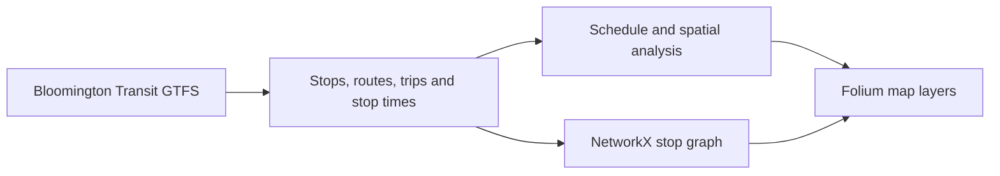
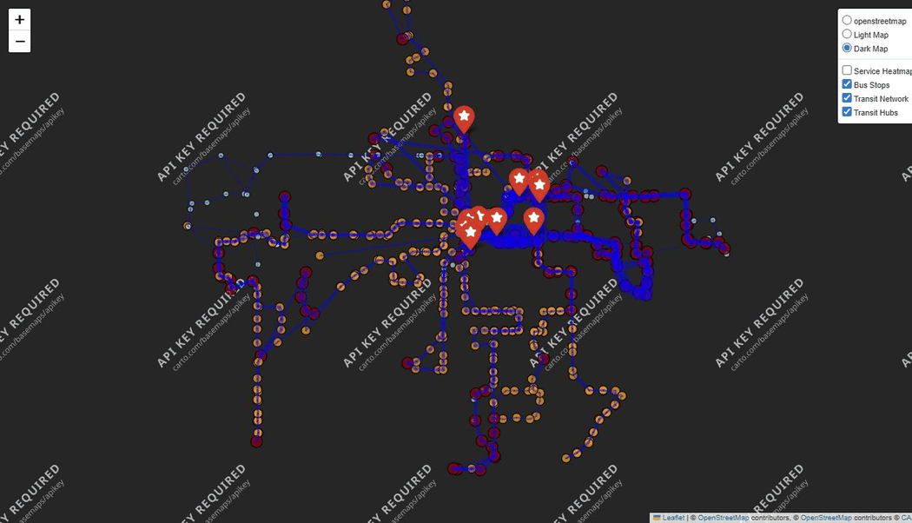

# Bloomington Multimodal Transit Analysis

A GTFS analysis project exploring bus service patterns, stop coverage, and network connections in Bloomington, Indiana. The notebook combines schedule data, geospatial plots, and a stop graph to support discussion about transit and multimodal connections.

## Run the saved map

From the repository directory, run:

```bash
python -m http.server 8780 --bind 127.0.0.1
```

Open [the local interactive map](http://127.0.0.1:8780/5_interactive_map.html). Zoom in and enable **Service Heatmap** from the layers control. The saved map loads Leaflet and basemap assets over the internet. No API key is required.

The saved export loaded in a browser with map tiles, zoom controls, and a working heatmap toggle. [Open the map source](5_interactive_map.html).

## Approach



The original [notebook](Bloomington_Multimodal_Transit_Analysis_2.ipynb) and [project notes](readme) describe the historical analysis and feed URL. The exact historical feed snapshot is absent, so the original numerical findings have not been reproduced here. The saved map illustrates bus service and possible connections. It does not measure actual walking or biking outcomes.

**Tools** · Python, pandas, NetworkX, Folium, Leaflet, GTFS.

## See it work


